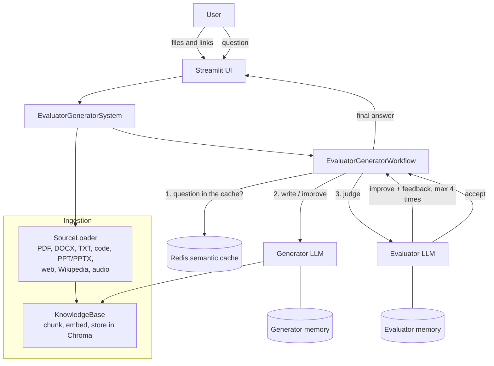

# Evaluator–Generator RAG Platform

A question-answering platform that does not only generate answers, but **checks them and improves them** before
the user sees them. A **Generator LLM** answers from the user's own sources, an **Evaluator LLM** judges every answer
with 7 criteria, and the two work in a feedback loop of at most 4 improvements. Each agent has its own isolated
memory, repeated questions are answered from a **Redis semantic cache**, and every step can be followed in
**LangSmith**.

Built with Python, LangChain (LCEL), Chroma, Redis, Google Gemini and Streamlit.

---

## Contents

1. [Features](#features)
2. [Architecture](#architecture)
3. [How it works](#how-it-works)
4. [Project structure](#project-structure)
5. [Setup](#setup)
6. [Running](#running)
7. [Test cases](#test-cases)
8. [Design decisions](#design-decisions)
9. [Limitations](#limitations)

---

## Features

| Requirement | Where |
|---|---|
| Upload files and give URLs in a user interface | `streamlit_app.py` |
| PDF, DOCX, TXT, source code, PPT/PPTX, web pages, Wikipedia, WAV audio | `src/loaders.py`, `src/speech.py` |
| Ingestion pipeline: load → extract → chunk → embed → store | `src/loaders.py`, `src/knowledge.py` |
| Retrieval of the relevant knowledge (hybrid: keywords + meaning) | `src/knowledge.py` |
| Generator LLM, grounded in the sources only | `src/generator.py` |
| Independent Generator memory | `src/memory.py` → `GeneratorMemory` |
| Evaluator LLM with 7 criteria and a decision | `src/evaluator.py` |
| Independent Evaluator memory | `src/memory.py` → `EvaluatorMemory` |
| Iterative feedback loop, maximum 4 improvements | `src/workflow.py` |
| Redis caching with invalidation | `src/cache.py` |
| LangChain chains and LCEL orchestration | every chain is built with LCEL (`RunnableBranch`, `RunnablePassthrough`, `RunnableParallel`, `RunnableLambda`) |
| Unknown or unsupported questions | Generator rules + Evaluator rules |
| Error handling and validation | every layer (see [Design decisions](#design-decisions)) |
| Logging and monitoring | `src/monitoring.py` (log files + LangSmith) |

---

## Architecture



The UI talks only to `EvaluatorGeneratorSystem` (`src/system.py`). It is the one place where every object is
created and given what it needs (dependency injection). This is also how the memories stay isolated: the Generator
is given only the Generator memory, and the Evaluator only the Evaluator memory.

---

## How it works

### 1. Ingestion (`loaders.py`, `speech.py`, `knowledge.py`)

Every source becomes LangChain `Document`s with metadata that says where the text came from
(file, page, slide, link). Each format has its own loader class; all of them inherit from one abstract
`FileLoader`, so a new format only needs a new class:

| Format | How it is read |
|---|---|
| PDF | one Document per page (`pypdf`) |
| DOCX | paragraphs, then tables row by row (`cell \| cell \| cell`) so a row stays together |
| PPTX | one Document per slide, with tables and **speaker notes** |
| PPT | converted to PPTX with LibreOffice, then read like PPTX |
| TXT / code | decoded text; code keeps its language, so it is split between functions and classes |
| Web page | the readable text, without menus, scripts and footers (`BeautifulSoup`) |
| Wikipedia | the plain text from the Wikipedia API (any language) |
| WAV / MP3 / M4A | speech to text with Faster-Whisper, on the CPU |

The Documents are split into chunks (about 1,000 characters, 150 overlap; code up to 1,500 by functions),
embedded with `intfloat/multilingual-e5-small` (multilingual, runs on the CPU) and stored in Chroma.
Adding a source again replaces its old chunks. Every change raises the **knowledge version**.

**Retrieval is hybrid.** A keyword search (BM25) and a meaning search (embeddings) run side by side
(`RunnableParallel`), and their results are merged with Reciprocal Rank Fusion. The keyword search finds exact
words (names, numbers, "Zarqa"), the meaning search finds paraphrases, and a chunk found by both goes to the top.

### 2. Generator (`generator.py`)

- A follow-up question ("And how much is the deposit for **it**?") is first rewritten into a question that can be
  understood alone, using the conversation history from the Generator memory.
- The 4 best chunks are given to the model as **numbered sources**, and every fact in the answer points to its
  source, like `[1]`.
- Grounding rules: only facts from the sources; if the sources do not have the answer, the fixed sentence
  *"The information needed to answer this question is not available in the provided sources."*; a partial answer
  says which part is missing; the answer is in the language of the question.
- **Prompt routing** (`RunnableBranch`): attempt 0 uses the first-answer prompt; attempts 1–4 use the improve
  prompt, which contains all earlier attempts and the feedback that each one received.
- Every attempt is saved in the Generator memory.

### 3. Evaluator (`evaluator.py`)

The Evaluator judges the answer against the **same sources**, with the 7 criteria stored in its own memory:
accuracy, relevance, completeness, consistency, grounding, no unsupported claims, overall quality.

- The model returns JSON scores (1–5) and feedback; the JSON is checked, and the model is asked once more
  (`with_retry`) if it is broken.
- **The decision is made in code, not by the model:** every criterion must reach its minimum score (4).
  This keeps the decision consistent.
- From the second round, the Evaluator reads its earlier feedback from its memory and checks that it was fixed.
- "Not available in the sources" is accepted when the sources really do not contain the answer.

### 4. Feedback loop (`workflow.py`)

```
question → rewrite if needed → semantic cache → (miss) → round: Generator → Evaluator
                                                           ├─ accept            → final answer
                                                           ├─ 4 improvements    → last answer + "could not be fully validated"
                                                           └─ otherwise         → feedback to the Generator, next round
```

The loop counter is part of the workflow state. The loop is pure LCEL: after every round a `RunnableBranch` picks
one of the three ways, and the third way returns the loop itself (a `RunnableLambda` that returns a Runnable),
so it runs again with the new state. The final answer is saved in the conversation history.

### 5. Memories (`memory.py`)

| | Generator memory (`generator_memory.db`) | Evaluator memory (`evaluator_memory.db`) |
|---|---|---|
| Stores | conversation history, every attempt, its retrieved context and the feedback it fixed | criteria and rules, every evaluation: scores, decision, feedback |
| Used for | follow-up questions, improvement attempts | checking earlier feedback, the decision rule |

Both are SQLite files, so they stay after the app is closed. They are isolated in three ways: separate files,
separate classes and objects, and an `owner` table in every file — opening the Evaluator file with the Generator
memory raises a `PermissionError` before anything is written.

### 6. Semantic cache (`cache.py`)

The final answer of a question is saved in Redis, and a question **with the same meaning** gets it back without
running the loop (the loop can take up to 10 model calls: 5 answers and 5 evaluations).

1. The question (after a follow-up is rewritten) is embedded and compared with every cached question.
2. If the closest one is similar enough (cosine ≥ 0.90), the light model is asked a short yes/no question:
   *do the two questions ask for exactly the same information, in the same language?*
3. Only then the saved answer is returned.

The second check is needed: in our tests "How much does an **e-bike** cost per hour?" and
"How much does a **city bike** cost per hour?" have a similarity of 0.94 — as close as a real paraphrase
(0.956–0.965) — but different answers.

Invalidation: the Redis key contains the knowledge version (`answers:v32`), so after a source is added or removed
the old answers are never used. Only answers accepted by the Evaluator are cached, entries expire after 7 days,
and if Redis is not running the app works without the cache.

### 7. Logging and monitoring (`monitoring.py`)

- Every module logs with `logging.getLogger(__name__)`; messages go to the screen and to `logs/app.log`
  (rotating, 1 MB × 3).
- **LangSmith**: with three lines in `.env`, every question becomes a trace. The chains have readable names
  (`Evaluator-Generator workflow`, `Feedback loop`, `Round`, `Generator`, `Evaluator`, `Hybrid search`,
  `Cache check`), and each trace carries `session_id` and `run_id`.

---

## Project structure

```
evaluator-generator-rag/
├── streamlit_app.py          # the user interface
├── src/
│   ├── system.py             # builds and connects all the parts (used by the UI)
│   ├── speech.py             # SpeechToText (Faster-Whisper)
│   ├── loaders.py            # Loader classes for every format + SourceLoader
│   ├── knowledge.py          # KnowledgeBase (Chroma, chunks, version) + KeywordIndex (BM25)
│   ├── memory.py             # GeneratorMemory, EvaluatorMemory (SQLite)
│   ├── llm.py                # GeminiModels (main + fast, with fallbacks)
│   ├── generator.py          # Generator
│   ├── evaluator.py          # Evaluator
│   ├── workflow.py           # EvaluatorGeneratorWorkflow (the loop)
│   ├── cache.py              # SemanticCache (Redis)
│   └── monitoring.py         # logging + LangSmith
├── sample_sources/           # a small fictional company ("Orbit Bikes") for testing every format
├── .streamlit/config.toml
├── requirements.txt
└── .gitignore
```

Every module can be tested alone: `python -m src.<module>` (for example `python -m src.workflow`).

---

## Setup

**1. Python packages** (Python 3.10 or newer):

```bash
python -m venv .venv
.venv\Scripts\activate          # Windows (Linux/macOS: source .venv/bin/activate)
pip install -r requirements.txt
```

**2. `.env`** in the main folder:

```
GEMINI_API_KEY=...
# optional, for monitoring:
LANGSMITH_TRACING=true
LANGSMITH_API_KEY=...
LANGSMITH_PROJECT=evaluator-generator-rag
# optional, the default is redis://localhost:6379
REDIS_URL=redis://localhost:6379
```

**3. Redis 8** (on Windows inside WSL Ubuntu; the same commands on Linux):

```bash
sudo apt-get install -y lsb-release curl gpg
curl -fsSL https://packages.redis.io/gpg | sudo gpg --dearmor -o /usr/share/keyrings/redis-archive-keyring.gpg
echo "deb [signed-by=/usr/share/keyrings/redis-archive-keyring.gpg] https://packages.redis.io/deb $(lsb_release -cs) main" | sudo tee /etc/apt/sources.list.d/redis.list
sudo apt-get update && sudo apt-get install -y redis
sudo service redis-server start
redis-cli ping                  # PONG
```

**4. LibreOffice** (optional) — only needed for old `.ppt` files.

The embedding model and Whisper are downloaded automatically the first time (about 470 MB and 500 MB).

---

## Running

```bash
streamlit run streamlit_app.py
```

- **Sidebar:** upload files, add a web page or Wikipedia link, see and remove sources, see if the cache and
  LangSmith are on.
- **Chat:** every answer shows whether it was accepted (and after how many improvements), whether it came from the
  cache, the numbered sources, and every round with its scores and feedback.

---

## Test cases

With the files of `sample_sources/` and the Wikipedia article *Bicycle-sharing system*:

| Question | Expected behaviour | Shows |
|---|---|---|
| How much does an e-bike cost per hour? | 6 JOD per hour, with source numbers | grounding, citations |
| What is the hourly price of an electric bike? (after the one above) | answered from the cache | semantic cache |
| How much does a city bike cost per hour? (after the one above) | **not** from the cache: 3 JOD | the cache check |
| And how much is the deposit for it? | rewritten to "... deposit for an e-bike?", 50 JOD | Generator memory |
| What do I get with the Plus plan, and how much does it cost? | 15 free hours, 10% off e-bikes, 25 JOD per month | table in DOCX |
| When will the Zarqa branch open? | March 2026 | speaker notes in PPTX |
| What time will the Irbid branch close next month? | 9 pm | audio (WAV) |
| How much is the late fee? | 2 JOD for every 15 minutes | source code |
| Who is the CEO of Orbit Bikes? | "not available in the provided sources", accepted | unknown questions |
| كم سعر الدراجة الكهربائية بالساعة؟ | answered in Arabic: 6 JOD | multilingual |
| (empty question) | "Please write a question." — no model is called | validation |
| An Evaluator that never accepts (test in `workflow.py`) | 5 rounds, then the last answer with the note | the maximum of 4 |

---

## Design decisions

- **Classes and dependency injection.** Every part is a class that gets what it needs from outside. This keeps the
  memories isolated, lets each part be tested with fake objects, and puts the whole wiring in one place
  (`system.py`).
- **Hybrid retrieval.** With meaning search only, the price page of the handbook was not in the top 4 for
  "How much does an e-bike cost per hour?" (it was crowded out by 88 Wikipedia chunks). Adding BM25 with
  Reciprocal Rank Fusion fixed it.
- **The improvement rounds reuse the sources of the first answer**, so the Evaluator judges every attempt
  against the same context.
- **Our own semantic cache instead of `RedisSemanticCache`.** The LangChain class caches every model call by its
  whole prompt; in this project every prompt starts with the same long rules, so different questions would look the
  same. It also needs an older version of the `redis` client. Caching the final answer by the question, with the
  knowledge version in the key and a yes/no check, is safer.
- **Error handling and validation:** empty or too long questions are rejected before any model call; unsupported
  file types, empty files, wrong links and missing Wikipedia pages give clear messages; the models have fallbacks
  (another Gemini model answers if one is busy); a broken Evaluator JSON is retried; if the models still fail the
  user gets a clear message and the error is logged; Redis or LangSmith being down never stops the app.

---

## Limitations

- Free Gemini models have daily limits; one question can use about 12 calls when the answer needs 4 improvements
  (5 answers, 5 evaluations, the rewrite of a follow-up question and the cache check).
- Arabic questions about English sources work (the embedding model is multilingual), but keyword search does not
  help across languages.
- Speech to text can mishear names (the sample recording says "Irbid", Whisper wrote "Irvid"); the meaning search
  still finds it.
- Scanned PDFs (images only) have no text to read.
